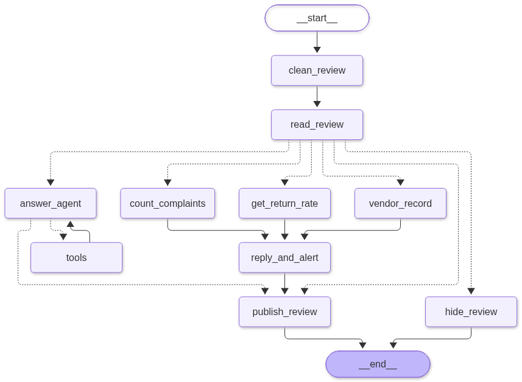

# Review Moderation

Review Moderation is a Python example of a review-processing workflow built with
[LangGraph](https://langchain-ai.github.io/langgraph/) and LangChain. It cleans
incoming product reviews, classifies them with a language model, and routes them
to moderation, customer support, or product-quality follow-up.

## Workflow



The workflow in `reviewer/graph.py` follows this path:

1. **Clean the review:** redact phone numbers, email addresses, and links.
2. **Classify it:** use structured model output to identify praise, a question,
   a complaint, or abusive content, and categorize complaints.
3. **Route it:**
   - Praise is published.
   - Abusive reviews are hidden for moderation.
   - Questions go to an answer agent, which can look up size charts, care
     instructions, and stock before drafting a short response.
   - Complaints trigger complaint-count, return-rate, and vendor-history
     lookups. The workflow then drafts a public reply and creates a quality
     alert before publishing the review.

The complaint lookups can run in parallel. Workflow state is defined in
`reviewer/state.py`; the example product, review, inventory, and vendor data are
currently stored in Python modules rather than an external database.

## Setup

Use a Python environment compatible with the package versions in
`requirements.txt`.

```bash
python -m venv .venv
source .venv/bin/activate
python -m pip install -r requirements.txt
```

The model client is configured to use OpenRouter with the `gpt-4o-mini` model.
Add your API key to a local `.env` file in the project root:

```dotenv
OPENROUTER_API_KEY=your_openrouter_api_key
```

Keep the key private; `.env` is excluded from version control.

## Run the example

From the project root, run:

```bash
python -m reviewer.graph
```

This executes the sample workflow and its demonstrations, which make model
requests and may incur API usage. It prints results and graph information to
the terminal. The moderation queue, published reviews, and quality alerts are
held in memory for the current process.

## Project layout

```text
.
├── graph.png                 # Workflow diagram shown above
├── requirements.txt          # Python dependencies
└── reviewer/
    ├── graph.py              # LangGraph workflows and runnable examples
    ├── state.py              # Shared workflow state and review schema
    ├── clean.py              # Personal-data and link redaction
    ├── classifier_node.py    # Model-based review classification
    ├── triage.py             # Routing and publish/moderation actions
    ├── tools.py              # Customer-support lookup tools
    ├── reply_and_alert.py     # Complaint replies and quality alerts
    ├── vendor.py              # Example complaint, returns, and vendor data
    └── config.py              # Model setup and sample reviews
```
